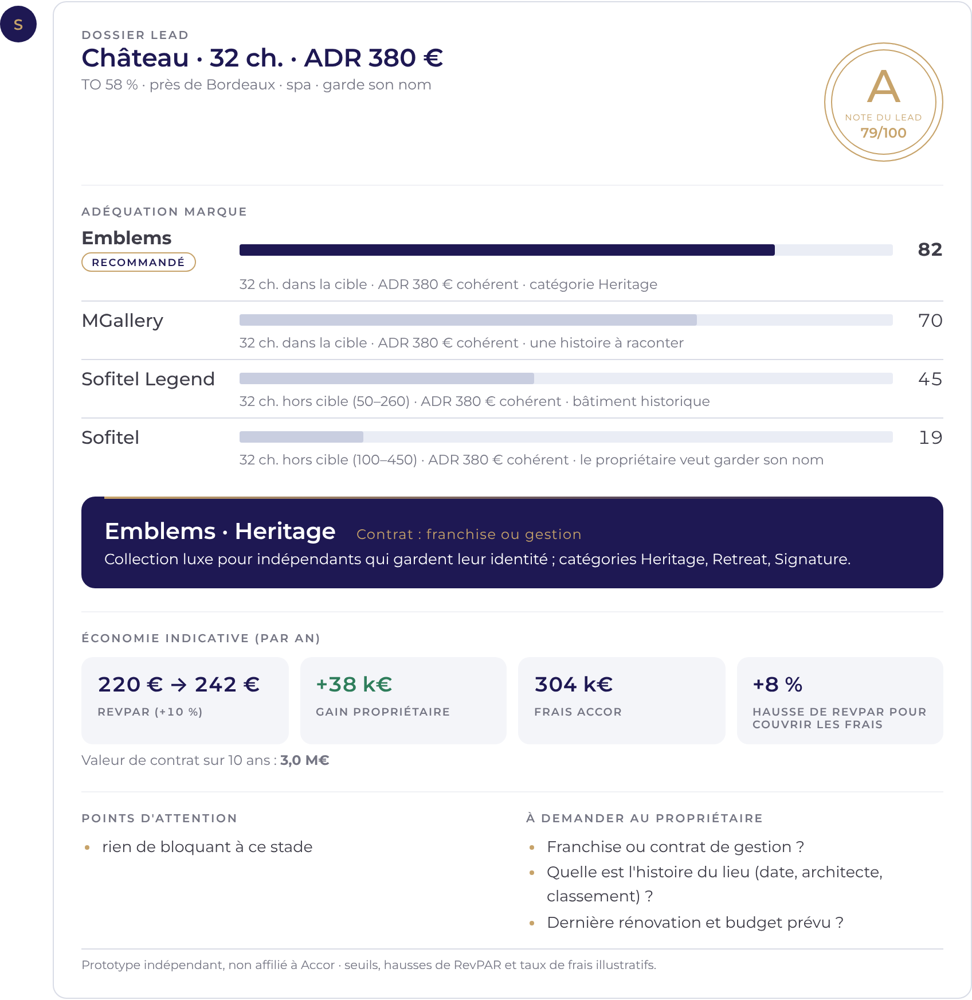
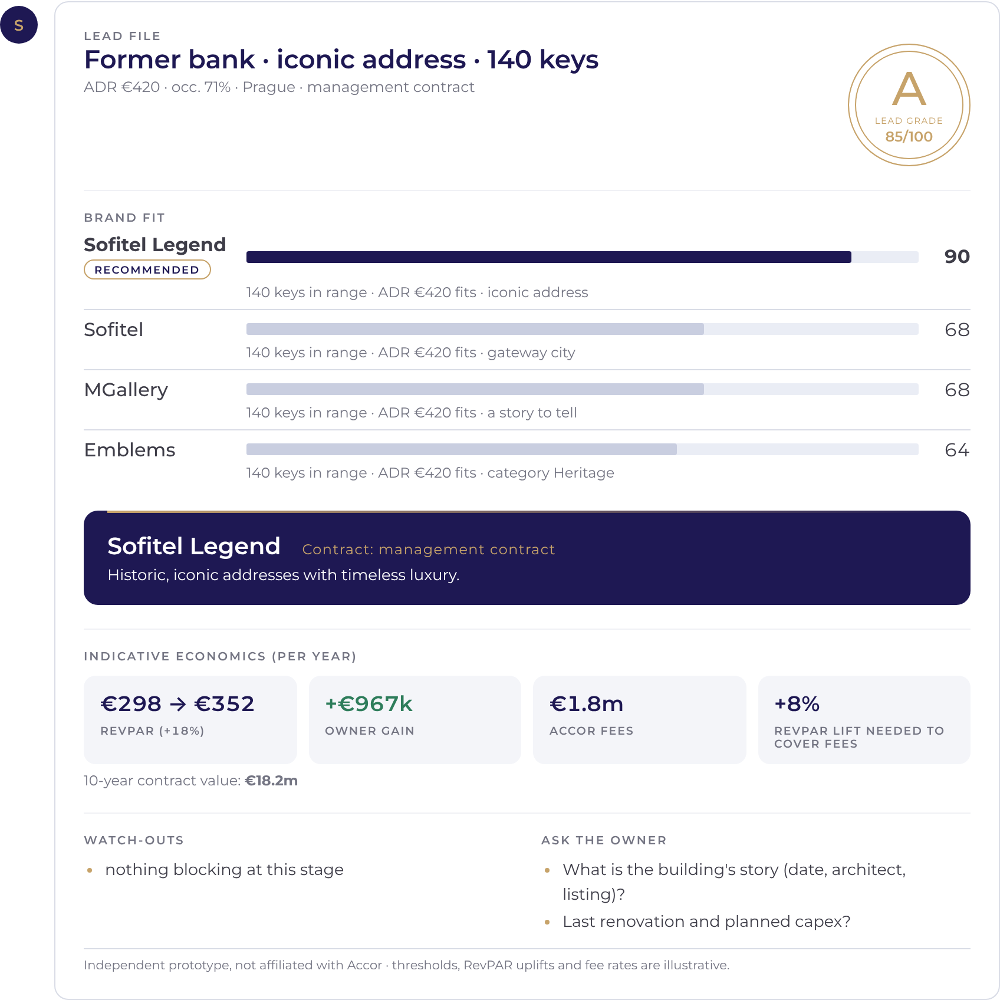
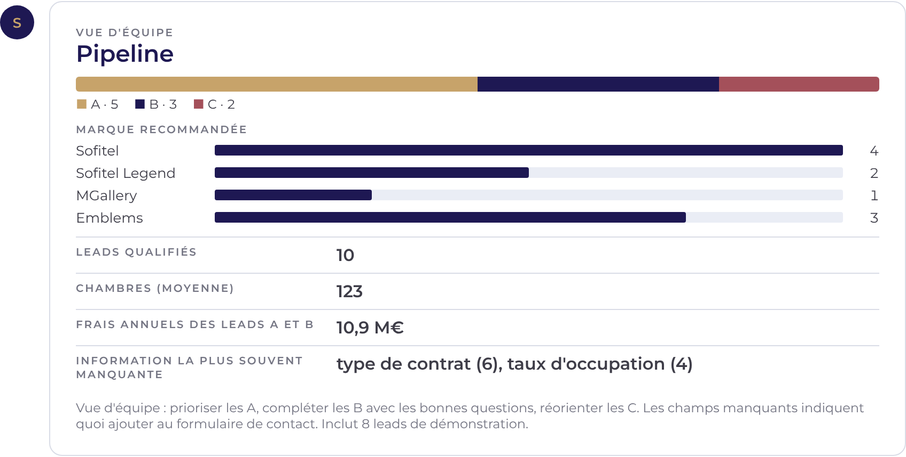

# Signature

**A lead-qualification assistant for luxury hotel development: Sofitel, Sofitel Legend, MGallery and Emblems.**
Describe a hotel or project in one sentence, in French or English. Signature recommends the best-fit brand, estimates the deal economics and grades the lead.

### ▶ [Try it live in your browser](https://anugrahasn1.github.io/signature-hotel-leads/)

## Why

Accor's luxury development team has seen leads triple since 2023. More leads means more time spent sorting them. Signature does the first pass in seconds, so developers spend their time on the hotels worth signing.

## What it does

> *"Château du XVIIIe à 40 min de Bordeaux, 32 chambres, spa, ADR 380 €, TO 58 %, le propriétaire veut garder son nom"*

| | |
|---|---|
| **Reads the lead** | Keys, ADR, occupancy, location (gateway city, resort), building type (château, riad, former bank…), story, design, spa, dining, meetings, owner wishes (keep the name, franchise or management), renovation or new build |
| **Brand fit** | Scores Sofitel, Sofitel Legend, MGallery and Emblems from 0 to 100, with the reasons, and names the Emblems category (Heritage, Retreat, Signature) |
| **Deal economics** | RevPAR today and branded, owner gain per year, Accor fees per year, the RevPAR lift needed to cover fees, 10-year contract value; switches between management and franchise |
| **Lead grade** | A / B / C with a score out of 100, watch-outs, and the questions still to ask the owner |
| **Follow-ups** | "et en franchise ?", "ADR 450", "60 chambres" update the same lead |
| **Pipeline** | `pipeline` shows the grade mix, brand mix, average size, annual fees of A and B leads, and which information is most often missing from inbound leads |

## Files

| File | Contents |
|---|---|
| `index.html` | The whole app, self-contained, served by GitHub Pages |
| `engine.js` | Parsing, brand-fit scoring, economics, lead grade, rendering |
| `build.py` | Builds `index.html` from `engine.js` |

## Honest limits

- **Brand thresholds, RevPAR uplifts and fee rates are illustrative assumptions**, not Accor data or contract terms. They show the method; with real figures the outputs become decision-grade.
- Owner economics use simple rules: 32% GOP margin, 60% flow-through on extra revenue, 5% of rooms revenue saved on own distribution and marketing.
- The pipeline view starts with 8 demo leads so it isn't empty on first visit.

## About

Built by **Anugraha SN**, BBA student at EDHEC Business School.
Independent student prototype, not affiliated with or endorsed by Accor. Brand names belong to their owner.
